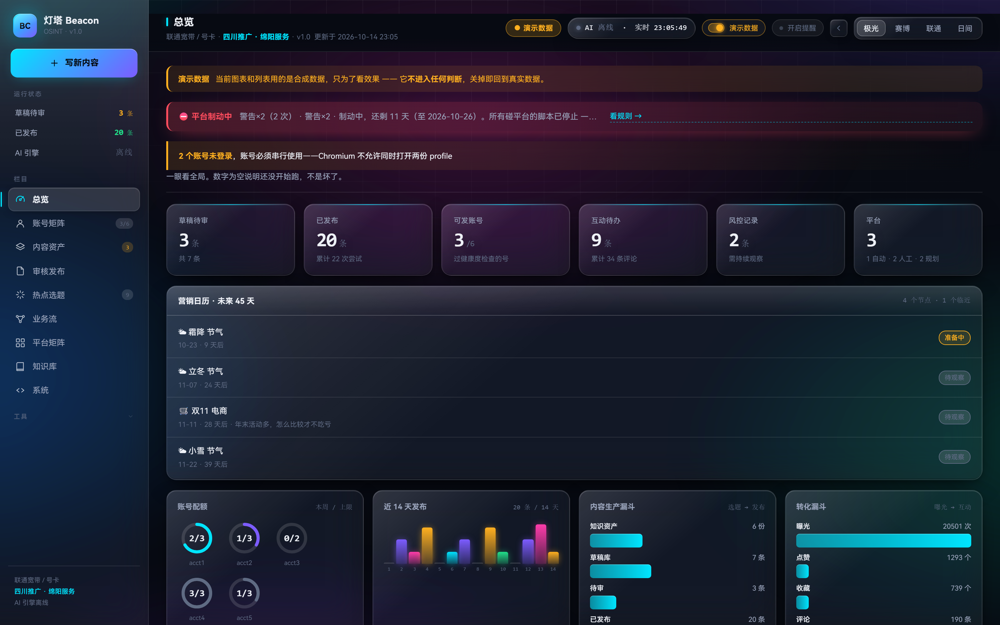
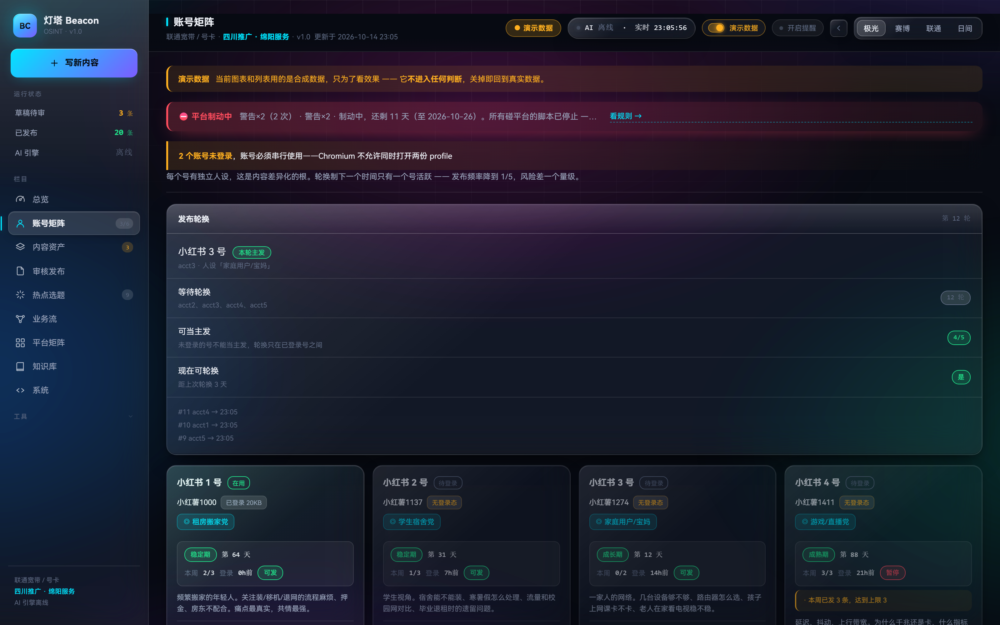
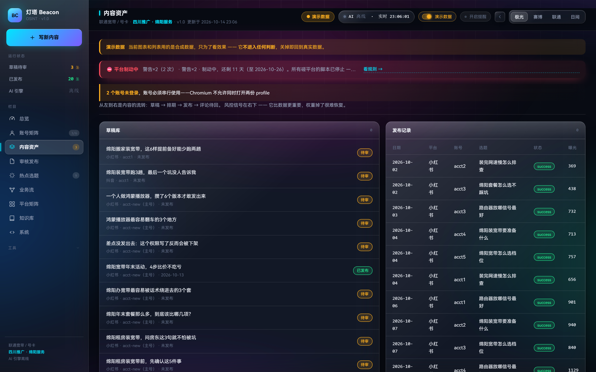
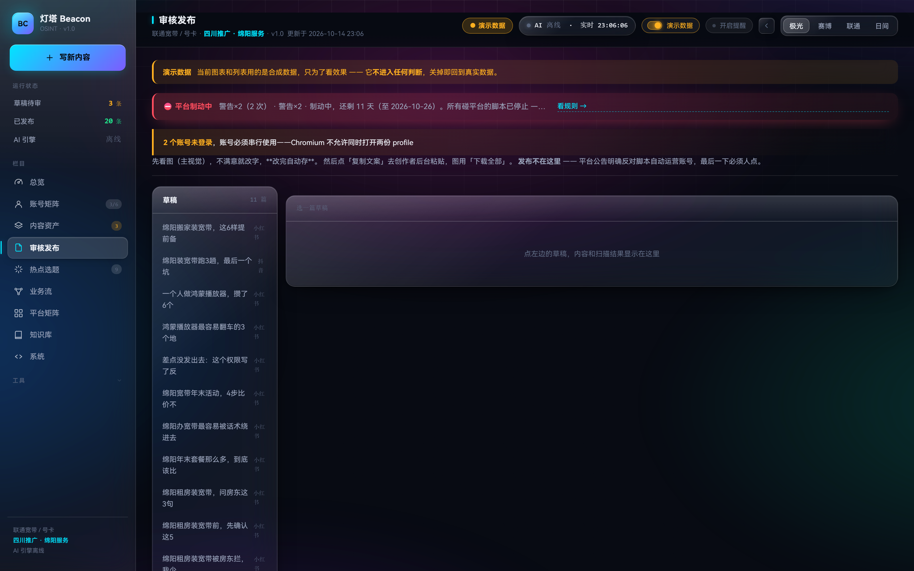
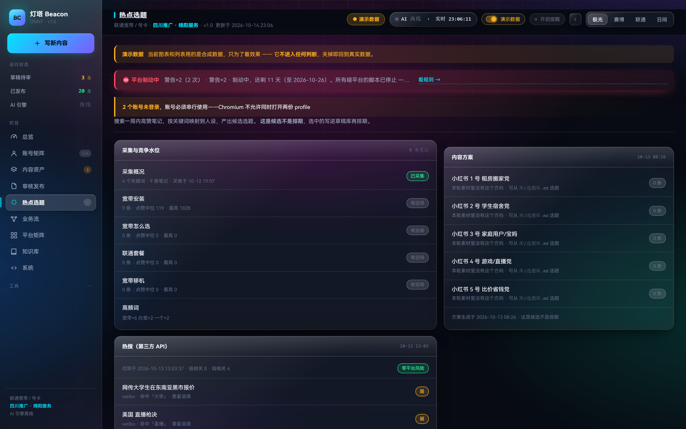
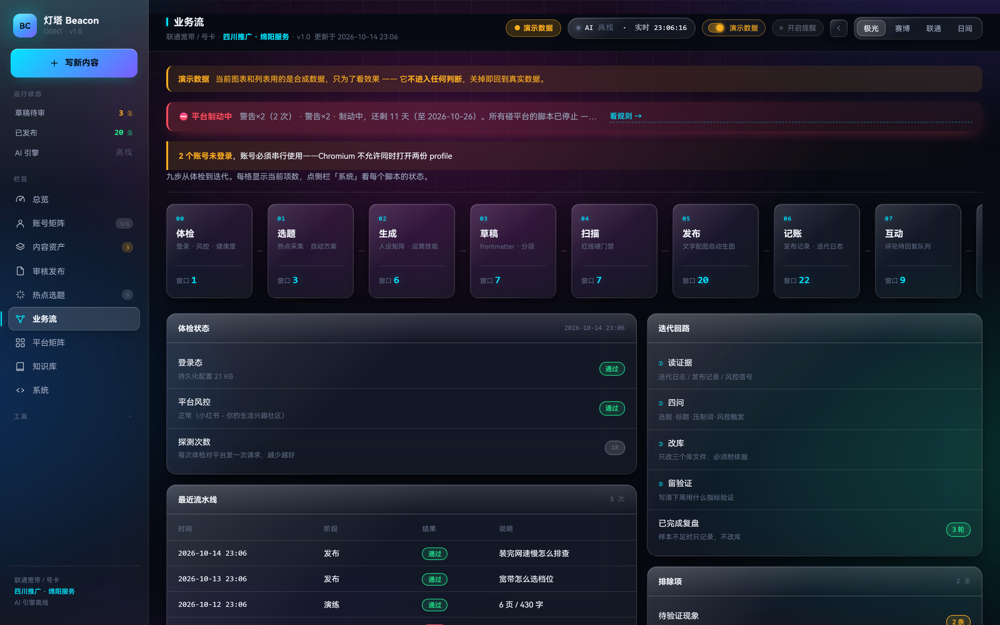
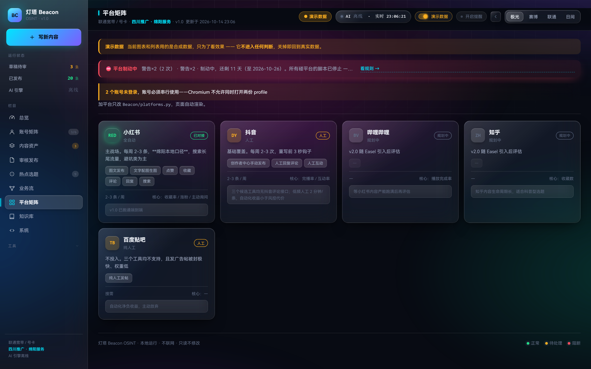
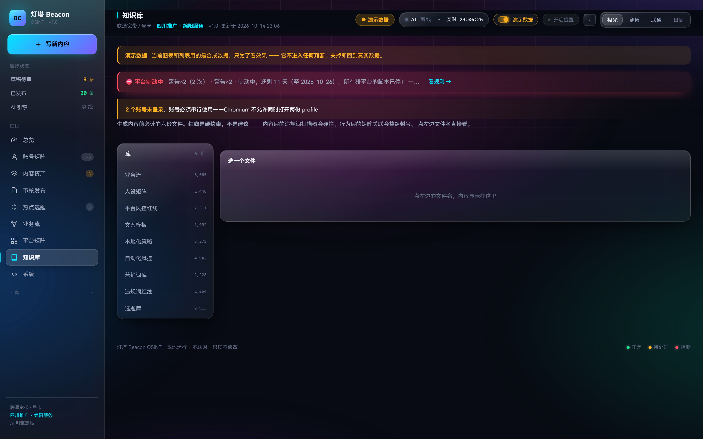
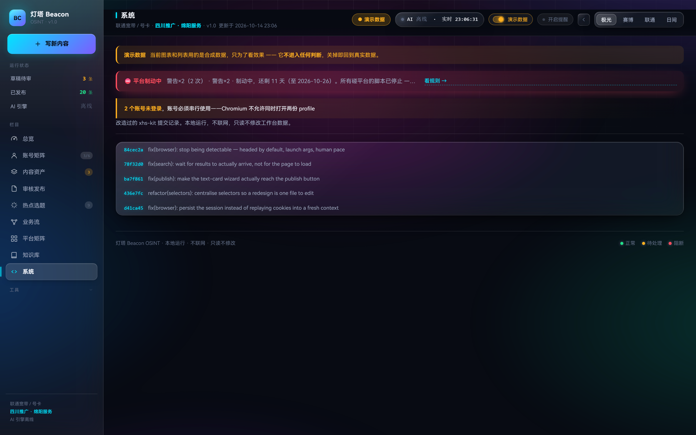

# 灯塔 Agent 社媒运营工作台

### Lighthouse Agent · Social Media Operations Workbench


> 面向 **本地号卡 / 宽带业务** 的社媒获客工作台。  
> 贴吧监控采集 · 意向智能分类 · 同行噪声过滤 · 内容生成 · 浏览器会话管理 · 风控红线硬门禁。
>
> **原则：采集归 AI，成交归人。**

🌐 **在线主页**：https://matou1118.github.io/lighthouse-agent-social-ops/

---

## 界面预览

工作台为深色极光主题，数据看板 + 账号矩阵 + 内容资产 + 全网平台矩阵。
以下截图取自 **演示数据模式**（合成数据，不含真实账号与客户信息）。

| 总览看板 | 账号矩阵 |
|---|---|
|  |  |

| 内容资产 | 审核发布 |
|---|---|
|  |  |

| 热点选题 | 业务流 |
|---|---|
|  |  |

| 平台矩阵 | 知识库 |
|---|---|
|  |  |



---

## 项目概要

`lighthouse-agent-social-ops` 是一个专为 **绵阳/四川本地卡商** 打造的工作台，帮助用户进行 **本地社媒获客**（含贴吧、本地论坛、分类信息平台），同时提供 **内容资产生成**（小红书/抖音）与 **数据运营**（采集、分类、提醒）支持。

### 为什么要开源？

1. **开放框架**：获取最新的运营技术和文档。
2. **专业可信**：提供值得信赖的开源社媒运营工具。
3. **持续改进**：社区共同维护，不断优化。
4. **节省资源**：免去重复开发，专注核心业务。

---

## 快速开始

### 1. 克隆仓库

```bash
git clone https://github.com/your-org/lighthouse-agent-social-ops.git
cd lighthouse-agent-social-ops
```

### 2. 运行环境检查

```bash
# 确认 Python 版本
python3 --version
# 建议: 3.10+

# 安装依赖
pip install -r requirements.txt

# 运行工作台检查
python lighthouse/run_check.py
```

### 3. 基本操作流程

#### A. 贴吧获客 (核心)

```bash
# 首次采集 (生成情报)
python lighthouse/tieba.py --verify    # 出情报报告

# 后台轮询 (每 10 分钟)
python lighthouse/tieba.py --watch      # 每 10 分钟轮询

# 查看待跟进意向 (按分数排序)
python lighthouse/tieba.py --leads     # 待跟进意向
```

#### B. 浏览器会话管理

```bash
# 打开平台浏览器（贴吧/本地论坛/58同城）
python lighthouse/browser_manager.py tieba
python lighthouse/browser_manager.py 58tongcheng

# 查看平台状态
python lighthouse/browser_manager.py --list
```

#### C. 注册试验 (AI 填表演示)

```bash
python lighthouse/registration_trial.py
# 浏览器自动填入测试数据，由你人工输入真实信息
```

#### D. 本地平台操作

```bash
# 小红书/抖音 内容生成（制动期内自动发布已停用）
python lighthouse/xhs_content.py  # 小红书文案生成
python lighthouse/douyin_content.py  # 抖音文案生成
```

---

## 项目架构

```
.
├── lighthouse/                    # 核心代码
│   ├── __init__.py
│   ├── tieba/                    # 贴吧监控模块
│   │   ├── __init__.py
│   │   ├── __main__.py           # 入口脚本
│   │   └── modules/             # 业务模块
│   ├── xhs/                      # 小红书模块
│   ├── douyin/                   # 抖音模块
│   ├── browser/                 # 浏览器会话管理
│   └── utils/                   # 通用工具
│
├── docs/                          # 文档与截图
│   ├── screenshots/              # 工作台截图
│   └── architecture.md          # 架构文档
│
├── data/                          # 示例数据结构 (请勿提交真实数据)
│   ├── templates/               # 数据模板
│   └── configs/                 # 配置模板
│
├── static/                       # 静态网页 (GitHub Pages)
│   └── index.html
│
├── README.md                      # 项目说明
└── LICENSE                       # 开源协议
```

---

## 主要功能

### 1. 贴吧监控

**采集**：按回复时间排序，过滤老帖，确保新鲜度。
**分类**：基于 6 类需求 + 求助语气识别，过滤同行/水楼/卖家。
**提醒**：批量桌面通知 + 可点击链接，一次批量推送高分意向。

```python
# 示例命令
python lighthouse/tieba.py --verify    # 出情报报告
python lighthouse/tieba.py --watch      # 每 10 分钟轮询
python lighthouse/tieba.py --leads     # 待跟进意向
```

### 2. 本地平台获取

**58同城**：商家入驻 + 服务信息发布，自动生成结构化数据。

**本地论坛**：西蜀论坛、江油论坛等 Discuz 社区，实施程序化内容生成。

**贴吧**：百度贴吧，提供高流量渠道，专注四川/绵阳相关话题。

### 3. 内容生成与管理

**小红书**：自动生成文案、图片、标签，填入后台，人工发布。

**抖音**：短视频文案生成，支持多平台内容复用。

### 4. 浏览器自动化

**浏览器会话管理**：Playwright 驱动的独立浏览器，会话自动保存，支持 AI 填表 + 人工审核流程。

**注册管理**：支持自动化注册试验，安全控制，防止滥用。

### 5. 数据处理与分析

**意向库**：结构化存储意向信息，支持按吧/分数/本地性检索。

**状态追踪**：跟踪每个意向的处理状态：待跟进、已跟进、无意向、已成交。

**情报报告**：定期生成情报报告，分析趋势、分布、质量等。

---

## 支持平台

| 平台 | 类型 | 支持状态 | 备注 |
|---|---|---|---|
| 百度贴吧 | 本地社区 | ✅ 核心 |
| 58同城 | 分类信息 | ✅ 核心 |
| 小红书 | 内容社区 | ✅ 内容资产 |
| 抖音 | 短视频 | ✅ 内容资产 |
| 本地论坛 | Discuz | ✅ 本地获取 |
| 豆瓣小组 | 社交社区 | ⚠️ 辅助 |

---

## 技术栈

### 后端

- **Python** (3.10+)：核心业务逻辑
- **aiotieba==4.7.1**：贴吧采集
- **playwright**：浏览器自动化
- **fastapi**：Web 框架 (可选)
- **APScheduler**：定时任务

### 前端

- **静态 HTML/CSS/JS**：GitHub Pages 托管
- **Tailwind CSS**：样式统一

### 数据

- **SQLite/JSON**：本地数据存储
- **SQLite**：意向库存储

### 安全性

- `.env` 存储敏感信息 (Git 忽略)
- 角色权限控制
- 网络请求限制

---

## 许可证

本项目采用 **MIT 许可证**。

```text
Copyright (c) 2026 Lighthouse Agent Team

Permission is hereby granted, free of charge, to any person obtaining a copy
of this software and associated documentation files (the "Software"), to deal
in the Software without restriction, including without limitation the rights
to use, copy, modify, merge, publish, distribute, sublicense, and/or sell
copies of the Software, and to permit persons to whom the Software is
furnished to do so, subject to the following conditions:

The above copyright notice and this permission notice shall be included in all
copies or substantial portions of the Software.

THE SOFTWARE IS PROVIDED "AS IS", WITHOUT WARRANTY OF ANY KIND, EXPRESS OR
IMPLIED, INCLUDING BUT NOT LIMITED TO THE WARRANTIES OF MERCHANTABILITY,
FITNESS FOR A PARTICULAR PURPOSE AND NONINFRINGEMENT. IN NO EVENT SHALL THE
AUTHORS OR COPYRIGHT HOLDERS BE LIABLE FOR ANY CLAIM, DAMAGES OR OTHER
LIABILITY, WHETHER IN CONTRACT, TORT OR OTHERWISE, ARISING FROM, OUT OF OR
IN CONNECTION WITH THE SOFTWARE OR THE USE OR OTHER DEALINGS IN THE SOFTWARE.
```

---

## 贡献指南

1. 分支：`main` -> `feature/your-feature`
2. 本地提交：`git add . && git commit -m "add: your message"`
3. 发送到远程：`git push origin feature/your-feature`
4. 创建 Pull Request

### 提交规范

- `feat: 添加新功能`
- `fix: 修复 bug`
- `docs: 文档`
- `style: 代码格式`
- `refactor: 重构`
- `test: 测试`
- `chore: 维护`

---

## 免责声明

本项目仅供学习和研究之用。使用过程中如有任何问题，请及时联系。

---

## 联系我们

如果您对本项目有任何疑问或建议，请访问我们的 GitHub 仓库提交 issue，我们将尽快回复。

**仓库链接：** `https://github.com/your-org/lighthouse-agent-social-ops`

---

本项目由 **Lighthouse Agent 团队** 维护。
